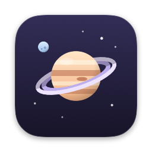
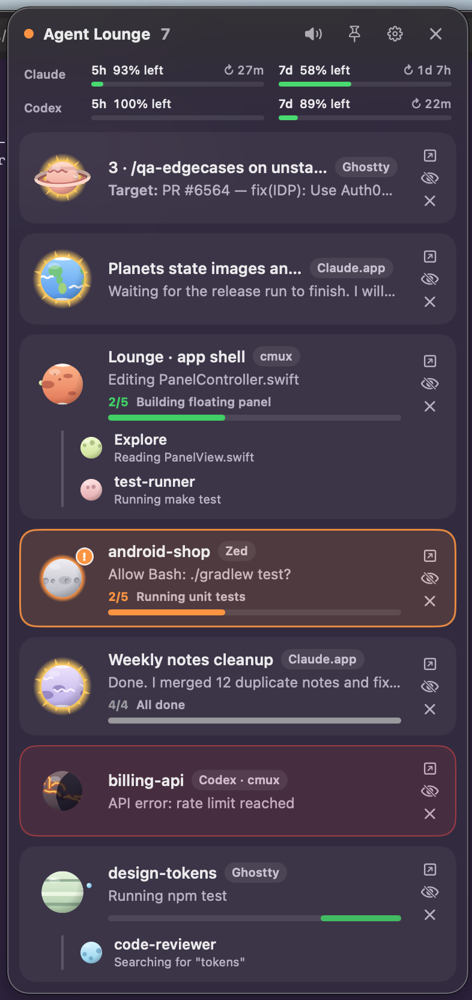
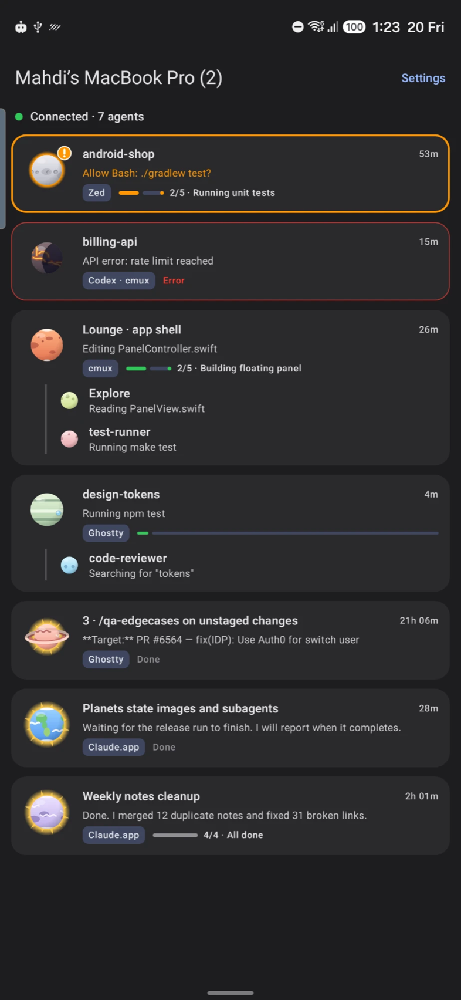

<p align="center">
  
</p>

<h1 align="center">Agent Lounge</h1>

<p align="center">
  All your AI coding agents in one menu-bar panel, with a phone companion.
</p>

<p align="center">
  <a href="https://github.com/mahdi-malv/agent-lounge/actions/workflows/ci.yml"></a>
  <a href="https://github.com/mahdi-malv/agent-lounge/releases/latest"></a>
  
  
  <a href="LICENSE"></a>
</p>

<table align="center">
  <tr>
    <th>macOS app</th>
    <th>Android companion</th>
  </tr>
  <tr>
    <td></td>
    <td></td>
  </tr>
</table>

---

Agent Lounge is a macOS menu-bar app that shows every running Claude Code and Codex session
in one panel. Each card shows the state (running, needs input, done, error), the current
activity, task progress, model, context use and the last message. Click ↗ to bring the
session's window to the front, also when it is minimized.

A usage bar at the top shows the plan limits of each agent (5-hour and weekly windows): percent left
and time to reset. Codex numbers come from its local session files. Claude numbers come from the
Claude usage API with your Claude Code sign-in: click **Show Claude usage…** in the panel (or
Settings → Panel) and allow Keychain access once. The phone shows the same bar.

Turn on **Show Notch Status** (right-click menu or Settings → Notch) for a small pill at the top
center of the screen, over the notch on a MacBook: top state and number of agents. Hover it to see
the sessions; click a row to show its window. It shows on the screen with the pointer, the screen
with the active window, the main screen, or all screens.

The optional Android companion shows the same cards on your phone, sends alerts, answers
Claude permission requests and types prompts into Ghostty sessions.

**Sources:** Claude Code CLI (any terminal, Zed), Claude Code in Claude.app, Codex CLI and the Codex app.

## Download

Get the latest build from [**Releases**](https://github.com/mahdi-malv/agent-lounge/releases/latest).

| Platform | File | Needs |
|----------|------|-------|
| macOS | `Agent-Lounge-<version>.dmg` | macOS 26, Apple silicon |
| Android | `Agent-Lounge-Companion-<version>.apk` | Android 7.0 or later |

The macOS app is not notarized. After you drag it to Applications, run once:

```sh
xattr -dr com.apple.quarantine "/Applications/Agent Lounge.app"
```

## Set up

1. Start the app. A sofa icon appears in the menu bar. (A menu-bar manager such as Thaw or
   Bartender can hide new icons; move it to the visible part.)
2. Right-click the icon → **Settings…** → **Hooks** → **Install…** for Claude Code and for Codex.
   - **Claude Code:** hooks go into `~/.claude/settings.json`. Running sessions pick them up at
     once. `CLAUDE_CODE_ENABLE_TODO_TOOLS=1` is set if not set (task lists → progress bars).
   - **Codex:** hooks go into `~/.codex/hooks.json`. Codex runs them only after you trust them:
     run `/hooks` in Codex (or Settings → Hooks in the Codex app).
   - A backup `<file>.agent-lounge-backup-<time>` is made before each change. Only Agent
     Lounge entries are changed. **Uninstall…** removes them again.
   - After you move the app, the status shows "outdated": click **Update…**.
3. Permissions, asked when first needed:
   - **Notifications:** alerts for needs input / error (and done, if turned on).
   - **Automation → Ghostty:** ↗ selects the session's Ghostty tab.
   - **Accessibility** (right-click menu → Grant Accessibility Access…): ↗ raises the right
     Zed window and restores minimized windows.

### Phone companion

1. On the Mac: Settings → **Phone** → turn on → **Pair a Phone…**.
2. On the phone: install the APK, open it, and enter the code.

The phone and the Mac must be on the same network (port 47822, Bonjour `_agentlounge._tcp`).
The connection is encrypted; see [`docs/PLAN.md`](docs/PLAN.md) §10.

## Use

- Click the menu-bar icon to open the panel. The dot shows the most urgent state; the number
  is the card count.
- The pin button keeps the panel open as a floating window you can drag.
- Card buttons: ↗ focus, hide (comes back on the next event), delete (gone for this session).
  No action stops an agent.
- Settings: sound and notification per alert kind, mute, auto-hide of done cards, sources
  on/off, launch at login.

### Focus per host

| Host | How ↗ works |
|------|-------------|
| Ghostty | AppleScript `focus` of the terminal with the session's tty |
| Zed | Raise the window titled with the project folder (Accessibility) |
| Claude.app | `claude://code/continue?session=…` |
| Codex app | `codex://threads/<id>` |
| Other | Activate the app, restore a minimized window (Accessibility) |

## How it works

```
agent hook → lounge-hook <claude|codex> → POST http://127.0.0.1:47821/events → app ⇄ phone (LAN, encrypted)
```

- `lounge-hook` (bundled in `Contents/Resources/bin/`) reads the hook JSON, adds host facts
  (terminal env, process chain, tty) and posts it with 250 ms timeouts. It prints nothing and
  always exits 0, so it never blocks an agent.
- The app listens on 127.0.0.1 only (the phone listener is off by default). Port: env
  `AGENT_LOUNGE_PORT` (hook and app) or `defaults write dev.agentlounge.AgentLounge port N` (app).
- Transcripts (`~/.claude/projects`, `~/.codex/sessions`) give model, context and the last
  message. `~/.claude/sessions` finds Claude sessions that started before the app.
- A card is removed on SessionEnd or when the agent process ends.

## Build from source

### macOS app

Needs Xcode 26 and [XcodeGen](https://github.com/yonaskolb/XcodeGen) (`brew install xcodegen`).
The Xcode project is generated from `macos/project.yml` and is not committed.

```sh
make run        # Debug build in build/, then (re)start the app
make test       # unit tests
make install    # Release build → /Applications/Agent Lounge.app (INSTALL_DIR=… to change)
make dmg        # Release build → build/Agent-Lounge.dmg
```

If a build fails:

| Message | What to do |
|---------|------------|
| `XcodeGen is missing` / `Xcode is missing` | Install the tool the message names, then run `make` again. |
| `accessing build database … disk I/O error` | Move the folder out of Downloads, Desktop or Documents (for example to `~/agent-lounge`), run `make clean`, and build again. Do not run two builds at once. |
| `_LSOpenURLsWithCompletionHandler() failed with error -600` | The app is installed but did not start. Run `open -a "Agent Lounge"`. |

**Stable signing (recommended).** Ad-hoc signing changes the app's identity on each build, so
macOS forgets the Accessibility and Automation permissions. Create a git-ignored `local.mk`:

```make
SIGN_IDENTITY := <SHA-1 from `security find-identity -v -p codesigning`>
SIGN_TEAM     := <team id (OU) of that certificate>
```

### Android app

Needs JDK 21+ (Gradle downloads JDK 25 for its daemon) and the Android SDK. Open `android/`
in Android Studio, or:

```sh
cd android
./gradlew testDebugUnitTest   # unit tests
./gradlew installDebug        # build and install on a connected phone
```

### Releases

Push a tag such as `v0.2.0`. The [Release workflow](.github/workflows/release.yml) builds the
DMG and the APK and attaches them to a GitHub release. To sign the APK with your own key, add
these repository secrets (otherwise it is signed with a throwaway debug key):

| Secret | Value |
|--------|-------|
| `ANDROID_KEYSTORE_BASE64` | `base64 -i release.jks` |
| `ANDROID_KEYSTORE_PASSWORD` | Keystore password |
| `ANDROID_KEY_ALIAS` | Key alias |
| `ANDROID_KEY_PASSWORD` | Key password |

## Project layout

```
macos/
  AgentLounge/        menu-bar app (Swift, SwiftUI + AppKit)
  AgentLoungeTests/   unit tests (Swift Testing)
  LoungeHook/         lounge-hook CLI that agents call
  project.yml         XcodeGen spec
android/              phone companion (Kotlin, Jetpack Compose)
scripts/              dev and packaging scripts
docs/                 design notes (PLAN.md) and progress log (PROGRESS.md)
Makefile              macOS build entry point
```

## Dev aids

| What | How |
|------|-----|
| Claude with hooks for one run | `make dev-hooks`, then `claude --settings build/dev/claude-hooks.json` |
| Codex with hooks for one run | `scripts/codex-dev.sh [codex args]` |
| Current cards / last payloads | `curl 127.0.0.1:47821/debug/sessions`, `/debug/events` |
| Hook install status | `curl 127.0.0.1:47821/debug/hooks` |
| Focus a card | `curl -X POST 127.0.0.1:47821/debug/focus -d '<card id>'` |
| Phone access status / pairing code | `curl 127.0.0.1:47821/debug/remote`, `curl -X POST 127.0.0.1:47821/debug/pair-code` (Debug) |
| Mock cards | right-click menu → Add Mock Sessions |
| Re-render the app icon | `make icon` |
| Open the panel at launch | `open "…/Agent Lounge.app" --args -openPanelAtLaunch YES` |

## Uninstall

1. Settings → Hooks → **Uninstall…** for each agent.
2. Turn off Launch at login, quit the app, delete `Agent Lounge.app`.

## License

[MIT](LICENSE)
